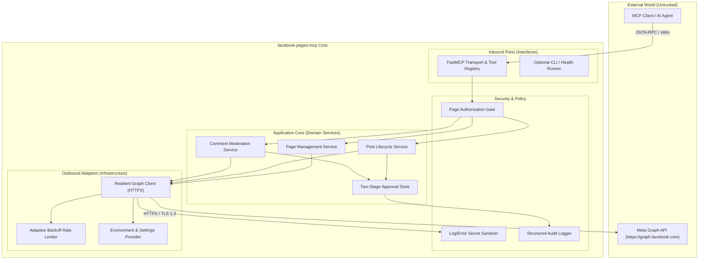
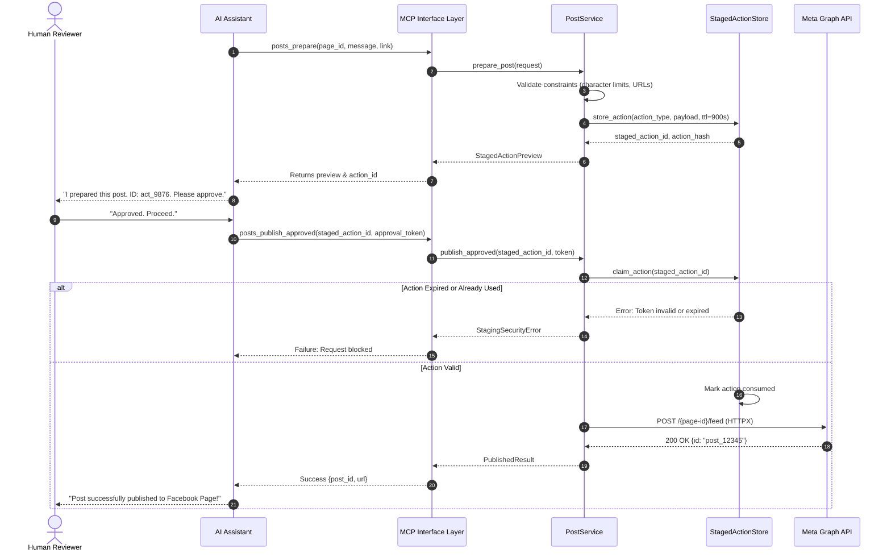

# System Architecture: facebook-pages-mcp

## 1. Architectural Vision & Boundaries

`facebook-pages-mcp` is designed as a **Modular Monolith** adhering to Hexagonal Architecture (Ports and Adapters) principles. The goal is to provide a zero-leakage, security-first bridge between AI assistants communicating over the Model Context Protocol (MCP) and Meta's official Graph API.

### Logical Boundaries

---

## 2. Layer Definitions & Separation of Concerns

### Layer 1: MCP Interface Layer (`fastmcp_facebook/interfaces/mcp/`)
- **Responsibilities:** Registers tools using the FastMCP framework, manages JSON-RPC serialization, and transforms domain objects into token-optimized response dictionaries.
- **Rules:** Contains no direct HTTP calls or business logic. All validation is driven by strict Pydantic v2 schemas.

### Layer 2: Application Service Layer (`fastmcp_facebook/services/`)
- **Responsibilities:** Implements use cases (discovering pages, staging posts, verifying approval tokens, publishing approved actions).
- **Rules:** Agnostic of MCP transport. Can be invoked directly from CLI, test harnesses, or background jobs.

### Layer 3: Security & Governance Layer (`fastmcp_facebook/security/`)
- **Responsibilities:**
  - Enforces two-stage approval lifetimes and single-use constraints.
  - Sanitizes all outgoing log events and error payloads to eliminate credential leakage.
  - Generates tamper-evident audit logs (`stderr`) for every write preparation and execution.

### Layer 4: Infrastructure & Meta Integration Layer (`fastmcp_facebook/infrastructure/`)
- **Responsibilities:**
  - Manages HTTP/2 and HTTP/1.1 connection pools using `httpx.AsyncClient`.
  - Parses Meta Graph API rate-limit headers (`X-App-Usage`, `X-Page-Usage`).
  - Implements bounded exponential backoff for transient network errors ($500$, $502$, $503$, $504$).

---

## 3. Data Flow: Two-Stage Publishing Flow

---

## 4. Evolution Toward Remote Deployment

While initial releases target local `stdio` execution for desktop AI tools (Claude Desktop, Cursor), the architecture is designed to evolve cleanly toward remote Streamable HTTP / Server-Sent Events (SSE):

1. **Identity & Multi-Tenancy:**
   - In local `stdio` mode, authorization is bound to the local OS user process and local environment variables.
   - In remote mode, the MCP server will integrate OAuth 2.1 Bearer Token validation, mapping authenticated tenant IDs to isolated per-tenant Page tokens stored in a secure secrets manager.
2. **Stateless Staging Store:**
   - The in-memory `StagedActionStore` will be backed by Redis or an encrypted transactional database with atomic token consumption (`GETDEL` / `UPDATE ... WHERE consumed=false`).
