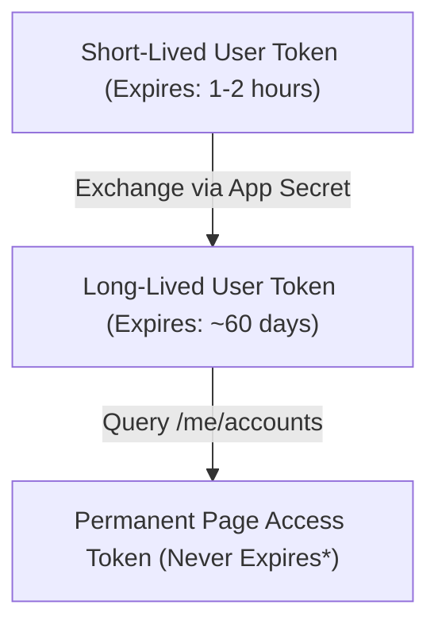

# Authentication & Token Management Guide

This guide details how to generate, exchange, and configure permanent (never-expiring) Page Access Tokens for `facebook-pages-mcp`.

---

## 1. Token Lifecycles in Meta Graph API

Meta uses a multi-tier token hierarchy:


*\*Note: A permanent Page Access Token remains valid indefinitely unless the user changes their Facebook password, revokes app permissions, or is removed from Page administration.*

---

## 2. Step-by-Step Guide: Generating a Permanent Page Access Token

### Step 1: Create a Meta App
1. Navigate to the [Meta for Developers Portal](https://developers.facebook.com/).
2. Click **My Apps** $\rightarrow$ **Create App**.
3. Select **Other** as the use case, then choose **Business**.
4. Set an App Name and App Contact Email.

### Step 2: Generate Short-Lived User Token
1. Open the **Graph API Explorer**: [developers.facebook.com/tools/explorer](https://developers.facebook.com/tools/explorer).
2. Under **Meta App**, select your newly created app.
3. Under **User or Page**, select **User Token**.
4. In the **Permissions** panel, add the following scopes:
   - `pages_show_list`
   - `pages_read_engagement`
   - `pages_read_user_content`
   - `pages_manage_posts`
   - `pages_manage_engagement`
5. Click **Generate Access Token** and approve the Facebook authorization prompt.

### Step 3: Exchange for a Long-Lived User Token
Using `curl` or our test script, call the `oauth/access_token` exchange endpoint:

```bash
curl -X GET "https://graph.facebook.com/v21.0/oauth/access_token?\
grant_type=fb_exchange_token&\
client_id=YOUR_APP_ID&\
client_secret=YOUR_APP_SECRET&\
fb_exchange_token=YOUR_SHORT_LIVED_TOKEN"
```

This returns a JSON response containing your 60-day `access_token`.

### Step 4: Extract the Permanent Page Access Token
Query the `/me/accounts` endpoint using the 60-day token:

```bash
curl -X GET "https://graph.facebook.com/v21.0/me/accounts?access_token=YOUR_LONG_LIVED_USER_TOKEN"
```

Find your Page in the JSON `data` array and copy the `access_token` associated with that specific Page ID.

Paste this into your `.env`:
```ini
FB_PAGE_ID=123456789012345
FB_PAGE_ACCESS_TOKEN=EAAG...
```
